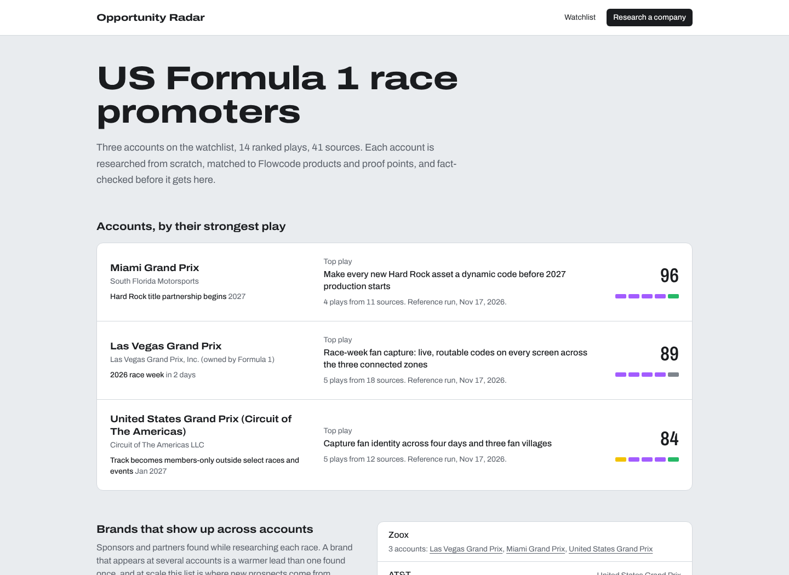
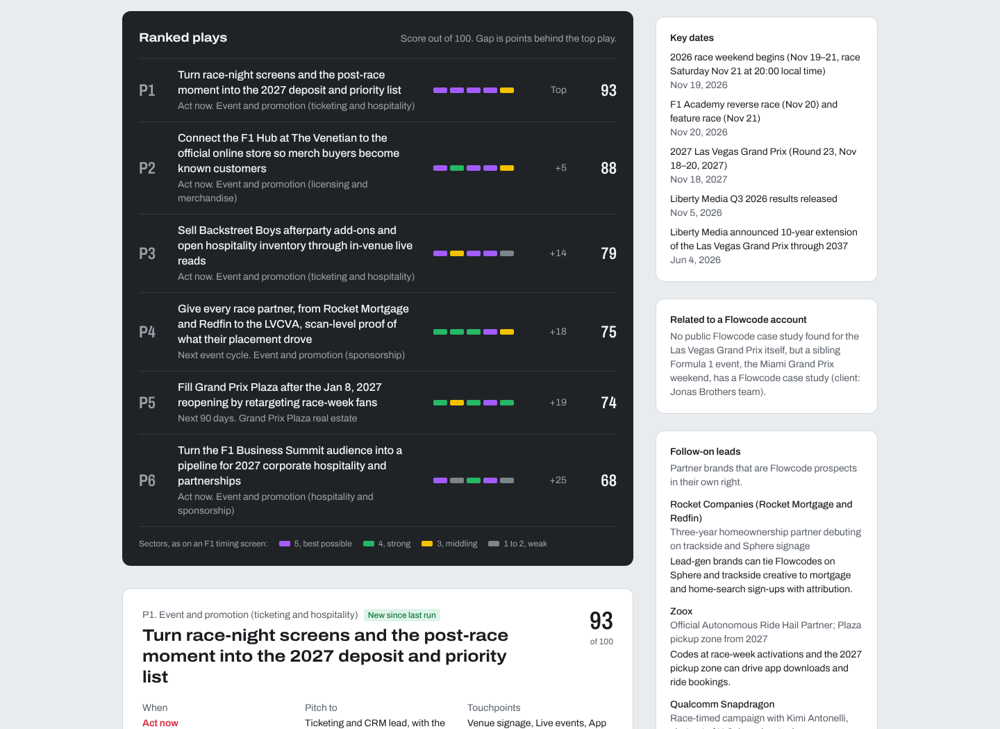

# Opportunity Radar for Flowcode

An agent that takes a company name or website, researches what the company is doing right now, and returns a ranked list of places Flowcode could help. Each play says what is happening, why Flowcode fits, how to run it, who to pitch, and where every fact came from.

The demo account list is the three US Formula 1 races: **Las Vegas** (race week starts Nov 19, 2026), **Miami** and **Austin (COTA)**. Each is run by a different company, which is a small version of the real job: many accounts, one method.



**Sample outputs** (Markdown, ready to paste into an email or CRM note):
[Las Vegas Grand Prix](data/reports/las-vegas-grand-prix.md) ·
[Miami Grand Prix](data/reports/miami-grand-prix.md) ·
[United States Grand Prix at COTA](data/reports/united-states-grand-prix.md)

> **About these samples.** Each report says how it was made: *Live API run* (the agent end to end on the Claude API), *Claude Code run* (the `/research` skill on a Claude plan, page-checked by code) or *Reference run* (research gathered with live web search on Nov 17, 2026 and written into the agent's schema by hand). All three kinds go through the same validation, scoring and ranking code.

## Two ways to run it

### On your Claude plan, with Claude Code (no API key, no per-call cost)

Claude Code signed in with a Pro, Max or Ultra plan uses the plan's included usage instead of API billing. The repo ships a `/research` skill that runs the same pipeline inside Claude Code.

```bash
npm install
claude                                   # sign in with your claude.ai account
> /research Las Vegas Grand Prix          # one company, name or URL
> /research data/targets/us-f1.json       # every company in a targets file, one subagent each
npm run dev                              # http://localhost:3000
```

The web app uses the same path. Run `npm run dev` on a machine where Claude Code is installed and signed in, open **Research a company**, and type any brand. The app starts Claude Code headless (`claude -p "/research <brand>"`), streams its progress into the page and opens the finished report. It removes `ANTHROPIC_API_KEY` from the environment it hands to Claude Code, so research always uses the plan, never API billing. Set `AGENT_RUNTIME=api` or `AGENT_RUNTIME=replay` to choose another engine. A hosted deployment without Claude Code replays saved reports.

Claude Code does the research and the judgment and writes `data/reference/<slug>.json` in the agent's exact schema. Then `npm run reports -- --check-sources` does what the API path gets from citations: it **downloads every cited page and checks that the quoted text is really on it**. A source whose quote is missing is dropped, and any play left without a source is dropped with it. Scoring, ranking and rendering are the same code as the API path.

### On the Claude API (the production path)

```bash
npm install
cp .env.example .env.local        # add ANTHROPIC_API_KEY
npm run agent -- "Las Vegas Grand Prix"    # one company
npm run batch -- data/targets/us-f1.json   # many, with --concurrency and --skip-fresh-days
```

API runs use the **lite** profile by default and stop at a **$0.75 spending cap per company**. Add `--full` for the Sonnet and Opus profile (about $2 per company, measured). The batch runner prints the profile, the search limit and the cap before it spends anything.

Without a key, the app and `npm run agent -- "COTA" --mock` replay saved reports. `npm test` runs the pipeline against a fake API and the page check against fake pages.

## How it works

```
company name or URL
        │
 1. Resolve        who is it, who operates it, which dates matter            1 search turn
        │
 2. Research       6 lenses in parallel, Claude server-side web search        ~30 searches
        │          campaigns · events · products/tickets · sponsors ·
        │          customer data/loyalty · strategy
        │
 3. Relationship   is it already on flowcode.com? (search limited to that domain)
        │
 4. Signals        research notes → discrete, dated, cited facts              structured output
        │
 5. Synthesize     signals + Flowcode catalog → plays and follow-on leads     structured output
        │
 6. Fact-check     a cheaper model checks each claim against cited snippets
        │
 7. Verify + rank  code drops unsupported items, scores, dedupes, diffs       deterministic
        ▼
 report.json + report.md + web view
```

**Sources come from the API, never from the model.** Every research turn uses Claude's server-side web search. The agent builds an evidence ledger from the API's own `web_search_result` blocks and `web_search_result_location` citations, and places `[E12]` markers in the notes where each cited sentence ends. Later steps can only refer to evidence by id. The verifier drops any signal whose ids are not in the ledger, and any play with no surviving signal. A model cannot invent a URL that reaches a report. The test suite includes a fake model that invents sources, and checks that they are stripped.

**Flowcode knowledge is a file, not a prompt.** `src/agent/flowcode.ts` holds the products and proof points (C3 Presents, NFL Shop, Penguins, Zach Bryan's tour, CLEAR), each with its flowcode.com source. The synthesis step must name products by id and attach a proof point only when it fits the vertical. When the product or the case studies change, you edit one file.

**Ranking is inspectable.** The model rates four judgment calls from 1 to 5 with a one-line reason: timing, scale, fit and access. Code computes a fifth, proof (how many independent sites back the play, and how fresh the newest fact is), and applies guardrails: a play built only on facts older than 12 months cannot score high on timing, and a play with one source is flagged. The total is a weighted sum mapped to 0-100:

| Timing | Fit | Scale | Proof | Access |
| --- | --- | --- | --- | --- |
| 25% | 25% | 20% | 15% | 15% |

In the UI the five components appear as sectors on an F1 timing screen: purple is the best possible rating, green strong, yellow middling, grey weak. A seller can see at a glance why the Vegas race-week play leads despite poor access (two days of lead time), and why Miami's fan-data play ranks lower (its evidence is from 2025).

**Two views built for a seller.** While research runs, the page shows it live: six lens tiles that light up like F1 sectors, counters for searches, pages read and distinct sites, a feed of every search and page, and the sites as they are found. Each finished report opens with a sources summary: how many sources and sites back it, how many quotes were confirmed, and the most cited sites.

**Change detection is built in.** Each run is compared with the previous report for the same company. New evidence URLs mark new signals, and plays without a close match in the last run are tagged "New since last run". This is the core of the always-on design below.

## What a play looks like

From the Miami report, the top-ranked play (score 96):

> **Make every new Hard Rock asset a dynamic code before 2027 production starts.**
> *What's happening:* Hard Rock takes the title from 2027, so track, paddock, fan-area and podium signage changes from Crypto.com to Hard Rock branding. The race is contracted through 2041 and drew a record 275,000 fans in 2024. [1][2][3][4]
> *Why Flowcode:* A rebrand forces a reprint, which is the cheapest moment to add codes. Flowcodes can be updated after printing, so assets made for 2027 keep working through 2041...
> *Pitch to:* Miami GP commercial and marketing leads, with Hard Rock partnership marketing. *When:* before 2027 signage production.

Each report also lists **follow-on leads**: partner brands that are Flowcode prospects in their own right. The watchlist rolls these up across accounts. Zoox shows up at all three races, which makes it a warmer lead than any brand found once.



## Tradeoffs I made

- **Fixed research lenses over a free-roaming agent loop.** Six parallel lenses give predictable cost, consistent coverage, and reports that compare across companies. A free agent can chase threads better, but its cost and coverage vary per company, which matters more at 1,000 accounts than at one.
- **Server-side web search over my own crawler.** Search, ranking and citations come in one API call, and citations make the evidence ledger possible. The cost is that evidence is a 150-character cited snippet, not the full page. The next step would be adding the web fetch tool for the company's own newsroom.
- **Model judgment plus deterministic scoring.** The model is good at "how timely is this", and bad at being consistent across 1,000 reports. Keeping the weights and guardrails in code makes the ranking tunable by a sales leader without touching prompts, and repeatable for the same inputs.
- **Model per step, with two cost profiles.** In lite, Haiku reads and extracts and Sonnet writes the plays. In full, Sonnet reads and Opus writes. Haiku always does the relationship check and the fact-check. All model ids are environment variables.
- **Two runtimes, one pipeline.** The API path is what scales: parallel lenses, the Batches API, spending caps, and sources that come from the API's own citations. The Claude Code path costs nothing per run on a Claude plan and is the right way to demo or research a handful of accounts, but a plan is built for ordinary individual use, not for refreshing thousands of accounts on a schedule. Its weaker spot is provenance: Claude Code writes the URLs and quotes itself, so the page check in code (`source-check.ts`) is what keeps invented sources out.
- **Precision over recall.** Plays without surviving evidence are dropped, not shown with a warning. Gaps the model infers ("no data capture described") are phrased as things to validate, and caveats are shown in a "Check before outreach" box.
- **A file store.** Reports are JSON files in `data/reports`. That is right for a demo and wrong for scale (see below).
- **Not built yet:** authentication, a scheduler, CRM push, web fetch, and a seller feedback loop. The design for each is below.

## Running it across thousands of companies

**Cost.** Measured on the first live runs (Nov 17, 2026): the **full** profile cost **$2.03 per company** for Las Vegas and Miami, with 35 searches and 108 to 122 sources each. Searches were only about $0.35 of that. The rest was the research model re-reading earlier search results each time a lens searched again, which grows quickly with searches per lens. That shaped three changes:
- **A lite default.** Haiku reads search results, Sonnet writes the plays, and each lens gets 3 searches instead of 5. Token cost for reading drops by about 20x, so search fees become most of the bill. Expect well under a dollar per company. The first lite runs will replace this estimate with a measured number, which every report prints.
- **A hard cap per company** ($0.75 lite, $3 full, set with `AGENT_MAX_COST_USD`). The cap is checked before every model call, so a runaway company stops instead of spending.
- **Full is opt-in** (`--full`) for accounts that justify deeper research.

At scale:
- Use the Message Batches API for scheduled refreshes. Tokens are 50% off and searches cost the same.
- Try dynamic filtering (`web_search_20260318`), where the model filters results in code before they reach its context. It targets exactly the re-reading cost above, but changes how citations come back, so it needs testing against the evidence ledger first.
- Do not re-research everything. A cheap monitor pass (Haiku, two searches, "anything new since date X?") costs a few cents and decides whether a company needs a full run. With weekly monitoring and full runs only on change, 1,000 accounts land in the low hundreds of dollars a week.

**Speed.** One company takes a few minutes because the six lenses run in parallel. Across companies it is a queue problem: workers pull companies, a concurrency limit keeps the organization's web search rate limit happy, and non-urgent refreshes go through the Batches API, which trades latency for price. `npm run batch -- <file> --concurrency N` is the small version of this.

**Keeping data fresh.** Freshness should follow the account, not a single cron:
- Refresh by tier and by proximity to a key date. Daily within 30 days of an event or launch (Vegas this week), weekly for active pipeline, monthly for the long tail. `--skip-fresh-days N` in the batch runner is the seed of this policy.
- Trigger on events, not only on time: company newsroom and RSS feeds, sponsorship announcements, earnings calendars, and event on-sale dates.
- Store evidence by normalized URL so a refresh only reads what is new, and keep every run so the diff can say what changed.
- Facts age in the score. Signals older than 12 months are flagged and cannot carry a "timely" play.

**Checking quality.**
- By construction: every URL in a report came from the search API, every play has at least one source, every output passes a schema.
- Per run: the fact-check verdict per play, dropped items with reasons, stale signal counts. All of it is in the report's quality section and visible in the UI.
- Offline: the three reference reports in `data/reference` are a starting golden set. On every prompt or model change, rerun them and compare scores, coverage of known signals, and an LLM-graded rubric for specificity (does the play name a touchpoint, a moment and a buyer?).
- Human: sample a small share of reports each week for review, and let sellers mark plays as used, wrong, or already known. Those labels tune the weights and become new eval cases.
- The metric that matters: share of plays a seller acts on, and meetings booked from them.

## Turning it into an always-on agent

```
 triggers                     agent                         where sellers see it
 ─────────                    ─────                         ────────────────────
 schedule (tiered)    ┐
 newsroom / RSS       ├──► monitor pass ──► full run ──► diff vs last run ──► CRM task + Slack alert
 event calendars      │    (cheap: is      (6 lenses)     (new signals,       when a new play scores
 sponsor announcements┘     anything new?)                 new plays)          above a threshold
                                                                │
 seller feedback  ◄────────────────────────────────────────────┘
 (used / wrong / known) ──► weights, prompts, eval set
```

1. **Accounts table** in Postgres: company, tier, owner, key dates, last run, next check. Reports become rows, one per run, with evidence stored by URL.
2. **Scheduler** (a cron worker or a queue like Inngest or SQS) picks accounts due for a check based on tier and key dates.
3. **Monitor pass** asks one cheap question per account: what is new since the last run? Only accounts with new evidence get the full six-lens run.
4. **Diff and alert.** The change detector already in the pipeline decides what is new. A new play above a score threshold creates a CRM task for the account owner and a Slack message with the one-line headline and a link to the report.
5. **Cross-account graph.** Sponsors found at one account become prospects, and a brand seen at several accounts moves up the list. Zoox at all three races is the first example.
6. **Feedback loop.** Seller labels on each play flow back into the scoring weights and the eval set, so the ranking learns what this team actually acts on.

## Project layout

```
src/agent/
  pipeline.ts        orchestration and progress events
  steps/research.ts  resolve, six lenses, relationship check, signal extraction
  steps/synthesize.ts plays, follow-on leads, fact-check
  evidence.ts        evidence ledger built from API citations
  score.ts           weights, proof strength, guardrails
  verify.ts          drop unsupported, dedupe, rank, diff
  flowcode.ts        products and proof points, each sourced
  render.ts          Markdown output
  source-check.ts    downloads cited pages and confirms each quote is on them
src/lib/claude-code.ts  runs /research through the Claude Code CLI for the web app
src/app/             Next.js UI: watchlist, report, live research view (streamed)
.claude/skills/research/  the /research skill: the same pipeline inside Claude Code
scripts/             run.ts (one company), batch.ts (many), build-reports.ts (research file to report)
data/targets/        account lists for batch runs
data/reference/      research files from Claude Code or by hand, one per company (also the golden set)
data/reports/        generated reports, JSON and Markdown
tests/               full pipeline against a fake API, scoring, verification, page check
```

Stack: Next.js 16, TypeScript, Anthropic TypeScript SDK (server-side web search, structured outputs), zod, Tailwind, Vitest.
